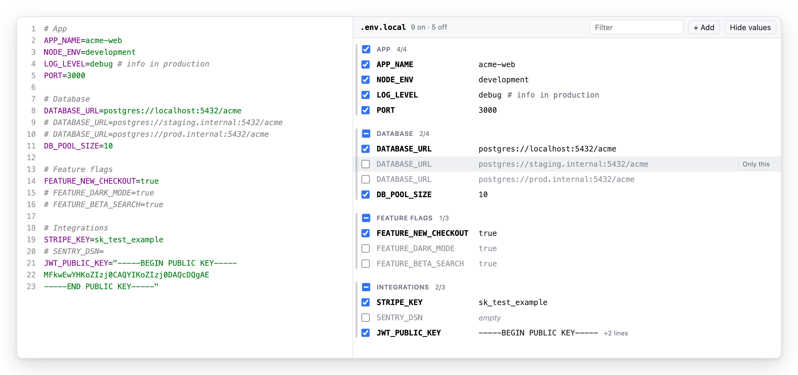

# Env Toggle

An [OpenIDEA](https://openidea.sh) plugin that shows `.env` files as a list of checkboxes.

<picture>
  <source media="(prefers-color-scheme: dark)" srcset="docs/screenshot-dark.png">
  
</picture>

- **Checked** = the line is active: `API_URL=http://localhost:3000`
- **Unchecked** = the line is commented out: `# API_URL=http://localhost:3000`

It opens beside the text editor, like the Markdown preview. Use the switch in the tab strip to choose **Editor Only**, **Editor and Preview** or **Preview Only**. Every change is a normal text edit, so Undo, Save and the dirty mark all work as usual.

Opens for: `.env`, `.env.*` (`.env.local`, `.env.production`, `.env.example`, …) and `*.env`. To get the plain text editor back for one file, use **Open as Text**.

## Install

- **From the marketplace:** in OpenIDEA, open **Settings › Plugins › Marketplace** and search for **Env Toggle**.
- **From a release:** download `devportolio.env-toggle-<version>.oiplugin` from [Releases](https://github.com/devportolio/openidea-env-toggle/releases), then use **Settings › Plugins › ⚙ › Install Plugin from Package File…**.

The plugin has no code, only a web page that edits the open file, so it asks for no permissions.

## Features

- **Checkbox per variable.** `export KEY=…` works too. Unchecking adds `# `; checking removes the `#` marks.
- **Groups.** A comment heading such as `# Staging` (or `#dev`) and the lines right under it form a group, up to the first blank line. The heading gets its own checkbox (all on / all off / mixed) that switches the whole group in one undoable step, and a bar in the left margin shows where the group ends. Variables after a blank line with no heading of their own are in no group.
- **Ranges.** Shift-click a second checkbox to switch every row between it and the one you clicked before.
- **Edit values in place.** Click a value to edit it; ↩ saves, Esc cancels, and clicking away saves. A multi-line value opens in a text box (⌘↩ or Ctrl+↩ saves). The rest of the line stays as written: the `#` of a line that is off, `export`, an inline comment, and the way the value is quoted when it still fits. The checkbox and the name still switch the line.
- **Add variables.** **+ Add** in the toolbar, or on a group's heading, opens a form for the name, the value, the group (or a new group) and whether it starts on. If the key is already on somewhere, the new line starts off so you can swap with **Only this**.
- **Multi-line values.** A quoted value that spans several lines, such as a PEM key, is switched as one block, so the file never ends up half commented.
- **Alternatives.** When a key appears more than once (say, a local, a staging and a production `DATABASE_URL`), hover a row and click **Only this** to switch that one on and the others off in a single undoable step.
- **Duplicate warning.** A key that is switched on in more than one place gets an "also on line N" badge.
- **Sections.** Comments become headings (`# Database`, `# --- Redis ---`) or notes, and rule lines become dividers. A short comment after a blank line, right above a variable, is a heading.
- **Filter** by key, value or comment. **Hide values** hides values while you share your screen.
- Follows the IDE's light or dark theme.

### How values are read and written

The view shows each value as the common readers load it, the [`dotenv`](https://www.npmjs.com/package/dotenv) package and Node's own reader (`--env-file`, `util.parseEnv`), and writes values so they load back exactly as typed:

- **Unquoted** when nothing needs quoting: `C:\temp\` or `{"name":"O'Reilly"}` are written as they are. An unquoted value ends at the first `#`.
- **Quoted** when it must be (a `#`, a line break, a space at either end, a quote at the start) or has spaces: `'…'` when it has no `'`, else `"…"` when it has no `"` or `\`, else `` `…` ``. A value with spaces inside that none of these hold is written unquoted, which readers load the same. Nothing is escaped, because readers don't undo escapes, except `\n` inside `"…"`, which is a line break.
- **Edits keep the line's style:** a quoted value stays in its quotes while they can hold it, and `"line1\nline2"` keeps its `\n`.
- **Refused, not changed:** a value that needs quotes but holds all of `'`, `"` and `` ` `` can't be written so it loads unchanged. **+ Add** and the editor say so and write nothing.

## Develop

The plugin has no Rust code and no build step. It is `plugin.toml` plus a web page in `web/`:

| File               | What it is                                                                                  |
| ------------------ | ------------------------------------------------------------------------------------------- |
| `plugin.toml`      | The manifest: one `customEditors` entry with `layout = "split"` and `web = "web/index.html"` |
| `web/envfile.js`   | Parsing and the edits: pure functions, no DOM                                               |
| `web/app.js`       | The page: reads and edits the document through `window.openidea.document`                  |
| `web/style.css`    | Styles, using the IDE's `--openidea-*` theme variables                                      |
| `test/`            | Tests (`npm install`, then `npm test`; Node 22.22 or newer): the parser and edits, what `dotenv` and Node's reader load from what the plugin writes, and the real page driven in jsdom |
| `dev/harness.html` | The page next to a textarea, with a fake IDE bridge, for working on the UI in a browser     |
| `dev/screenshot.html` | The README screenshots: a sample file beside the page (`npm run screenshots`, needs Chrome) |

```sh
npm install                   # test tools only: dotenv, jsdom
npm test                      # all tests
npm run dev                   # then open http://localhost:5178/dev/harness.html
openidea-plugin check .       # validate the manifest the way the IDE does
openidea-plugin link .        # load this folder into OpenIDEA without installing
```

After a change, use **Reload from disk** on the plugin in **Settings › Plugins** (or run **Reload Plugins**), then reopen the `.env` tab.

`openidea-plugin` comes from an OpenIDEA release or `cargo install --locked --git https://github.com/l0ng-ai/openidea ide-host --bin openidea-plugin`.

## Release

The plugin is listed through the [openidea-plugins registry](https://github.com/l0ng-ai/openidea-plugins) under the publisher `devportolio`, whose signing key stays with the maintainer and never in this repository (`.gitignore` excludes `*.key`).

1. Bump `version` and `change-notes` in `plugin.toml`, and run `npm test`.
2. Pack and sign:
   ```sh
   openidea-plugin pack . --key ~/.config/openidea/devportolio.key --publisher devportolio \
     --out dist/devportolio.env-toggle-<version>.oiplugin
   shasum -a 256 dist/devportolio.env-toggle-<version>.oiplugin
   ```
3. Tag `v<version>`, push, and attach the `.oiplugin` to a GitHub release of that tag.
4. In the registry, add a `[[versions]]` table to `plugins/devportolio.env-toggle.toml` with the release URL and the SHA-256, and open a pull request.

## License

MIT
